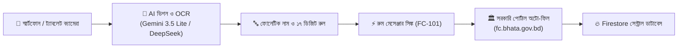

# 🪪 Family Card NID AI Scanner & Auto-Filler
### সম্পূর্ণ ক্লাউড-ইন্টিগ্রেটেড, মোবাইল ও অ্যান্ড্রয়েড ট্যাবলেট ভিত্তিক সমাধান
> **Full Cloud-Integrated, Mobile & Android Tablet Form Automation Bridge for Bangladesh Family Card (`fc.bhata.gov.bd`)**

[](https://familycard.afridi.app)
[](https://github.com/ShadhinAfridi/FamilyCard)
[](LICENSE)
[](https://aistudio.google.com/)
[](https://familycard.afridi.app)
[](https://firebase.google.com/)

---

## 🌐 লাইভ লিংক ও পরিবেশ (Live Environments)

- 🌐 **Cloudflare Production Domain**: [https://familycard.afridi.app](https://familycard.afridi.app)
- ⚡ **Cloudflare Edge Staging**: [https://familycard-10n.pages.dev](https://familycard-10n.pages.dev)
- 📱 **Mobile Tablet Bookmarklet Setup**: [https://familycard.afridi.app/bookmarklet/](https://familycard.afridi.app/bookmarklet/)
- 🐙 **GitHub Repository**: [https://github.com/ShadhinAfridi/FamilyCard](https://github.com/ShadhinAfridi/FamilyCard)
- 🏛️ **Target Government Portal**: [fc.bhata.gov.bd/online-application-family-card](https://fc.bhata.gov.bd/online-application-family-card)
- 🔥 **Firestore Tracking Databases**: `rajbari-city-app-16601` এবং `questionbank-diu` (Collection: `family_cards`)

---

## 📑 সম্পূর্ণ প্রজেক্ট ডকুমেন্টেশন ইনডেক্স (Documentation Index)

এই প্রজেক্টের প্রতিটি মডিউলের বিস্তারিত কারিগরি বিবরণ নিচে সংযুক্ত করা হলো:

```
FamilyCard/
├── README.md                            # 📌 কেন্দ্রীয় পরিচিতি ও সারসংক্ষেপ (Current File)
└── docs/
    ├── ARCHITECTURE.md                  # 🏛️ সিস্টেম আর্কিটেকচার, ক্লাউড টপোলজি ও ট্রিপল-রিডান্ড্যান্ট সিঙ্ক
    ├── AI_OCR_ENGINE.md                 # 🧠 Gemini ও DeepSeek ডুয়াল-এআই, ফোনেটিক ট্রান্সলিটারেশন ও খরচ ইঞ্জিন
    ├── FORM_AUTOMATION_SPEC.md          # 📋 সরকারি পোর্টালের ১১টি ধাপের রিঅ্যাক্টিভ DOM অটোমেশন স্পেক
    ├── API_REFERENCE.md                 # 🔌 সম্পূর্ণ REST API, WebSocket (Socket.IO) ও Firestore স্কিমা
    ├── DEPLOYMENT_AND_SETUP.md          # 🚀 লোকাল সার্ভার, Cloudflare Edge, Render ও Firebase ডিপ্লয়মেন্ট
    └── USER_OPERATOR_GUIDE.md           # 📖 মাঠ পর্যায়ের অপারেটর ও এনিউমারেটরদের জন্য সচিত্র ইউজার ম্যানুয়াল
```

### বিস্তারিত গাইডগুলোর সরাসরি লিংক:
1. [**🏛️ System Architecture Guide**](file:///C:/Users/shadh/Desktop/FamilyCard/docs/ARCHITECTURE.md)
   - হাই-লেভেল সিস্টেম ডিজাইন, ক্লায়েন্ট টপোলজি এবং অফলাইন ক্যাশিং।
   - ট্রিপল রিডান্ড্যান্ট সিঙ্ক: Socket.IO $\leftrightarrow$ Cloudflare Edge Worker $\leftrightarrow$ Google Cloud Firestore REST।
2. [**🧠 AI OCR, Transliteration & Cost Engine**](file:///C:/Users/shadh/Desktop/FamilyCard/docs/AI_OCR_ENGINE.md)
   - Gemini 3.5 Flash-Lite, 3.8 Flash, 4 Argon এবং DeepSeek Flash মডেলের কর্মক্ষমতা ও খরচ তুলনা।
   - ১০, ১৩ ও ১৭ ডিজিটের NID এবং ১৭ ডিজিটের জন্ম নিবন্ধন সনদ (BRC) রুল ও জন্মসাল (YYYY) প্রিফিক্সিং।
   - বাংলা থেকে ক্যাপিটাল ইংরেজি (ALL CAPS) ফোনেটিক স্বয়ংক্রিয় রূপান্তর অ্যালগরিদম।
3. [**📋 Government Portal Form Automation Specification**](file:///C:/Users/shadh/Desktop/FamilyCard/docs/FORM_AUTOMATION_SPEC.md)
   - `fc.bhata.gov.bd` (Vue.js / Vuetify) এর ধাপ ০ থেকে ধাপ ৯ পর্যন্ত সম্পূর্ণ ফিল্ড ম্যাপিং।
   - সেকশন ৫ ও সেকশন ৭ এর মধ্যে স্বয়ংক্রিয় ক্রস-ম্যাচিং এবং মোট ২৫০০ টাকার সঠিক বণ্টন সূত্র।
4. [**🔌 API & Data Schema Reference**](file:///C:/Users/shadh/Desktop/FamilyCard/docs/API_REFERENCE.md)
   - `/api/ocr-nid`, `/api/room-messages`, `/api/error-logs` এবং `/api/info` এন্ডপয়েন্ট বিবরণ।
   - WebSocket রিয়েল-টাইম ইভেন্ট এবং Firestore কালেকশন স্কিমা (`family_cards`, `room_channels`, `fc_error_logs`)।
5. [**🚀 Deployment, Build & Infrastructure Guide**](file:///C:/Users/shadh/Desktop/FamilyCard/docs/DEPLOYMENT_AND_SETUP.md)
   - লোকাল Node.js রানটাইম ও Windows `start.bat` সেটআপ।
   - Terser বুকমার্কলেট বিল্ড স্ক্রিপ্ট (`scripts/build_bookmarklet.js`)।
   - Cloudflare Workers, Firebase Hosting এবং Render.com ক্লাউড ডিপ্লয়মেন্ট।
6. [**📖 Field Operator & Enumerator Manual**](file:///C:/Users/shadh/Desktop/FamilyCard/docs/USER_OPERATOR_GUIDE.md)
   - একক ডিভাইস (ট্যাবলেট ক্রোম) ও ডুয়াল-ডিভাইস (স্মার্টফোন + ট্যাবলেট) ফিল্ড ব্যবহারের নির্দেশিকা।
   - ক্যামেরায় সঠিক ছবি তোলার কৌশল এবং সচরাচর সমস্যার সমাধান (FAQ)।

---

## 🌟 মূল বৈশিষ্ট্যসমূহ (Core Highlights)



### ১. প্লে-স্টোর লকড ট্যাবলেটে জিরো-ইনস্টল বুকমার্কলেট
- কোনো অ্যান্ড্রয়েড অ্যাপ বা এক্সটেনশন ইনস্টল করার প্রয়োজন নেই।
- ট্যাবলেট ক্রোম ব্রাউজারে মাত্র ১ লাইনের বুকমার্কলেট (`loader.min.js`) দিয়েই সরকারি পোর্টালের ওপর সরাসরি ভাসমান **`📸 NID স্ক্যান`** বাটন যুক্ত হয়।
- অফলাইন লোকালস্টোরেজ ক্যাশিং মেকানিজম থাকায় একবার লোড হলে ইন্টারনেট ড্রপ করলেও এটি সক্রিয় থাকে।

### ২. ডুয়াল-এআই ভিশন ও সাশ্রয়ী খরচ ইঞ্জিন
- **ডিফল্ট মডেল**: `gemini-3.5-flash-lite` — মাত্র **~$১.১১** (~৳১৩৫) প্রতি ১,০০০ NID কার্ড স্ক্যান।
- **DeepSeek Flash অফ-পিক মোড**: মাত্র **~$০.৩৮** (~৳৪৬) প্রতি ১,০০০ NID স্ক্যান।
- **স্বয়ংক্রিয় ফলব্যাক**: কোনো কার্ড অস্পষ্ট বা আলো কম হলে স্বয়ংক্রিয়ভাবে `gemini-3.8-flash` দিয়ে নির্ভুল তথ্য উদ্ধার করে।

### ৩. ১০, ১৩ ও ১৭ ডিজিটের এনআইডি এবং জন্ম নিবন্ধন রুল
- **স্মার্ট NID (১০ ডিজিট)**: সরাসরি যাচাই।
- **পুরাতন লেমিনেটিং NID (১৩ ডিজিট)**: সরকারি পোর্টাল ১৩ ডিজিট সাপোর্ট করে না। সিস্টেম জন্ম তারিখ থেকে জন্ম সাল (YYYY) বের করে ১৩ ডিজিটের পূর্বে যোগ করে স্বয়ংক্রিয়ভাবে ১৭ ডিজিট তৈরি করে।
- **ডিজিটাল জন্ম সনদ (১৭ ডিজিট)**: প্রথম ৪ ডিজিট জন্ম সালের সাথে মিলিয়ে "জন্ম নিবন্ধন" অপশন নির্বাচন করে।

### ৪. পিতা ও মাতার নামের স্বয়ংক্রিয় ইংরেজিকরণ (ALL CAPS)
- এনআইডি কার্ডে পিতা ও মাতার নাম শুধু বাংলায় থাকলেও AI ও ফোনেটিক ইঞ্জিন স্বয়ংক্রিয়ভাবে সরকারি পাসপোর্ট স্ট্যান্ডার্ড অনুযায়ী ক্যাপিটাল ইংরেজি বানান তৈরি করে (যেমন: `সিরাজ ব্যাপারী` $\rightarrow$ `SHIRAJ BEPARI`)।

### ৫. ক্রস-ডিভাইস রুম মেসেঞ্জার (রুম কোড: `FC-101`)
- মাঠ সহকারী নিজের সাধারণ স্মার্টফোন দিয়ে লাইনে দাঁড়ানো নাগরিকদের ছবি তুলবেন।
- ভেতরে বসা অপারেটরের ট্যাবলেটে ২ সেকেন্ডে ফর্ম পূরণ হয়ে যাবে।
- সহকারী ফোনে আবেদনকারীর মোবাইল নম্বর টাইপ করলেই ট্যাবলেটে ভেসে উঠবে এবং ১-ক্লিকে ফর্মে বসে যাবে।

### ৬. সেকশন ৩–৯ স্বয়ংক্রিয় ডাটা ও ২৫০০ টাকা বণ্টন অ্যালগরিদম
- **সেকশন ৩ (ছবি ও সনদ)**: ০/৩ থেকে ৩/৩ অনুপাত ট্র্যাকিং।
- **সেকশন ৪ (ঠিকানা)**: ইউনিয়ন, ওয়ার্ড, গ্রাম ও পোস্ট কোড অটো-সিলেক্ট।
- **সেকশন ৫ ও ৭ (ক্রস-ম্যাচ)**: সদস্য সংখ্যা ও প্রবাসী আয়ের সামঞ্জস্য যাচাই।
- **সেকশন ৯ (২৫০০ টাকা বণ্টন)**: পরিবারে শিক্ষার্থী ও বয়োবৃদ্ধদের উপস্থিতির ওপর ভিত্তি করে মোট ২৫০০ টাকার সঠিক বিভাজন।

---

## ⚡ দ্রুত শুরু করার নিয়ম (Quick Start)

### পদ্ধতি ক: মাঠ পর্যায়ের অপারেটরদের জন্য (কোনো কোডিং লাগবে না)
1. ট্যাবলেটে গুগল ক্রোমে যান: **`https://familycard.afridi.app/bookmarklet/`**
2. **"📋 বুকমার্ক কোড কপি করুন"** বাটনে চাপ দিয়ে কোডটি কপি করুন।
3. ক্রোমে যেকোনো পেজ বুকমার্ক (⭐) করে URL বক্সে কোডটি পেস্ট করুন এবং নাম দিন `nid`।
4. সরকারি পোর্টালে যান: `https://fc.bhata.gov.bd/online-application-family-card`
5. অ্যাড্রেসবারে লিখুন `nid` এবং বুকমার্কে ট্যাপ করুন!

### পদ্ধতি খ: ডেভেলপার ও লোকাল সার্ভার সেটআপ
```bash
# ১. গিট ক্লোন করুন
git clone https://github.com/ShadhinAfridi/FamilyCard.git
cd FamilyCard

# ২. ডিপেনডেন্সি ইনস্টল করুন
npm install
npm run install:server

# ৩. পরিবেশ ভেরিয়েবল সেট করুন
cp server/.env.example server/.env
# server/.env ফাইলে আপনার GEMINI_API_KEY বসান

# ৪. সার্ভার চালু করুন (অথবা start.bat ফাইলে ডাবল-ক্লিক করুন)
npm start
```

ব্রাউজারে খুলুন: `http://localhost:3000`

---

## 🗄️ ফায়ারবেস সেন্ট্রাল ডাটাবেস রেকর্ড ফরম্যাট

সফল প্রতিটি আবেদন রিয়েল-টাইমে Firebase Firestore-এ ব্যাকআপ হয়:
- **Collection**: `family_cards`
- **Document ID**: `8743033825` (নাগরিক NID/BRC)

```json
{
  "family_id": "8743033825",
  "program_name": "ফ্যামিলি কার্ড",
  "nid_number": "19862611234567890",
  "name_bn": "সিরাজ ব্যাপারী",
  "name_en": "SHIRAJ BEPARI",
  "father_bn": "সিরাজ ব্যাপারী",
  "father_en": "SHIRAJ BEPARI",
  "mother_bn": "নুরজাহান নেছা",
  "mother_en": "NURJAHAN NESA",
  "mobile_number": "01956887894",
  "dob": "1986-04-12",
  "age": 38,
  "gender": "পুরুষ",
  "marital_status": "বিবাহিত",
  "religion": "ইসলাম",
  "nationality": "বাংলাদেশী"
}
```

---

## 🛠️ প্রযুক্তি স্ট্যাক (Technology Stack)

- **Frontend & Companion UI**: Pure Vanilla JavaScript (ES6+), HTML5 Camera Stream Canvas API, CSS3 Glassmorphism.
- **Client Injections**: Manifest V3 Chrome Extension, Pure Minified Bookmarklet Loader, Userscript.
- **Backend & Real-Time Sync**: Node.js, Express 4.x, Socket.IO 4.8.
- **Edge Serverless**: Cloudflare Pages, Cloudflare Workers API.
- **Cloud Database & Hosting**: Google Cloud Firestore, Firebase Hosting.
- **AI Vision Providers**: Google Gemini API (`@google/genai`), DeepSeek API.
- **Build Toolchain**: Terser minification engine.

---

## 👨‍💻 অবদান ও ক্রেডিট (Authors & License)

- **ডেভেলপার**: **Shadhin Afridi** & **Binary ICT**
- **GitHub**: [@ShadhinAfridi](https://github.com/ShadhinAfridi)
- **লাইসেন্স**: এই প্রকল্পটি [MIT লাইসেন্স](LICENSE) এর আওতাভুক্ত।
