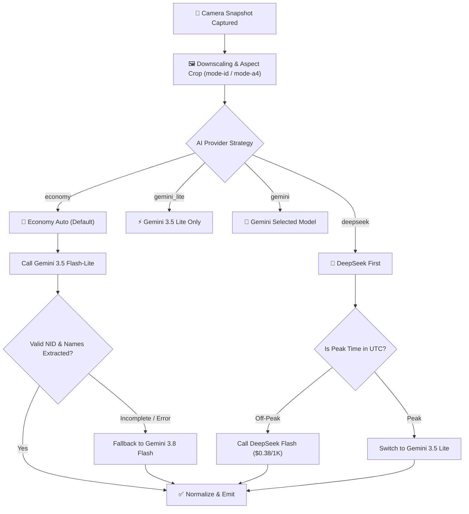
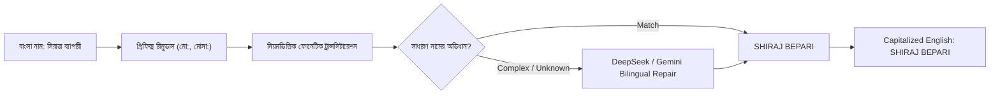

# 🧠 AI OCR, Transliteration & Cost Engine

The **FamilyCard AI Engine** provides automated optical character recognition (OCR), intelligent transliteration, document validation, and cost optimization for Bangladeshi identification cards.

It processes high-variance mobile phone camera captures of National Identity Cards (NID) and Digital Birth Registration Certificates (BRC), extracting structured applicant profiles formatted specifically for the government family card database.

---

## 1. Supported AI Vision Models & Cost Topology

The engine integrates both **Google Gemini Vision** and **DeepSeek Vision** through a tiered, cost-optimized routing architecture:

| Model ID | Provider | Input Cost / 1M | Output Cost / 1M | Est. Cost / 1,000 NIDs | Rate Quota | Primary Use Case |
| :--- | :--- | :--- | :--- | :--- | :--- | :--- |
| **`gemini-3.5-flash-lite`** | Google Gemini | **$0.30** | **$2.50** | **~$1.11** (~৳135) | 4K RPM / 150K RPD | **Default Production Model**: High-speed, balanced accuracy for clear photos. |
| **`gemini-3.8-flash`** | Google Gemini | **$0.75** | **$3.75** | **~$2.53** (~৳309) | 1K RPM / 10K RPD | **Precision Engine**: Used for low-light, skewed, or worn-out physical cards. |
| **`gemini-4-argon`** | Google Gemini | **$2.00** | **$10.00** | **~$6.50** (~৳793) | 500 RPM / 5K RPD | **Diagnostic Benchmark**: Highest reasoning fidelity for severely damaged cards. |
| **`gemini-3.1-flash-lite`** | Google Gemini | **$0.25** | **$1.50** | **~$0.78** (~৳95) | 4K RPM / 150K RPD | **Ultra-Low Cost Gemini**: Legacy budget option. |
| **`deepseek-flash` (Off-Peak)** | DeepSeek | **$0.15** | **$0.60** | **~$0.38** (~৳46) | Dynamic | **Maximum Economy**: Lowest cost per scan during off-peak windows. |
| **`deepseek-flash` (Peak)** | DeepSeek | **$0.30** | **$1.20** | **~$0.76** (~৳93) | Dynamic | Standard peak-hours execution. |

*Calculated at exchange rate: $1 USD = 122 BDT.*

---

## 2. Dynamic Routing Strategies (`aiProvider`)

The engine dynamically selects and cascades between models depending on the operator's strategy:



### Strategy Definitions:
1. **`economy` (Default)**: Executes `gemini-3.5-flash-lite` as the primary engine. If extracted fields lack essential attributes (NID number, date of birth, or Bengali name), it automatically triggers an in-flight fallback to `gemini-3.8-flash`.
2. **`deepseek`**: Routes to DeepSeek Flash, prioritizing off-peak execution rates.
3. **`gemini_lite`**: Locks execution strictly to Gemini Flash-Lite to maintain a predictable operational expenditure.
4. **`auto`**: Dual-AI failover. Reads user credentials from primary key slot; on network error or quota exhaustion (`RESOURCE_EXHAUSTED`), cascades to the secondary provider.
5. **`gemini`**: Direct execution of operator-selected Gemini model (`3.5`, `3.8`, or `4`).

---

## 3. DeepSeek Peak-Time Detection Algorithm

DeepSeek offers substantial pricing discounts during non-peak UTC hours. The system checks the client and server timestamp against the official DeepSeek peak schedule:

```javascript
function isDeepSeekPeakUtc(nowMs = Date.now()) {
  const d = new Date(nowMs);
  const day = d.getUTCDay(); // 0 = Sunday, 6 = Saturday
  if (day < 1 || day > 5) return false; // Weekends are always Off-Peak
  const hour = d.getUTCHours();
  // Peak windows: 01:00-04:00 UTC and 06:00-10:00 UTC
  return (hour >= 1 && hour < 4) || (hour >= 6 && hour < 10);
}
```

The UI displays real-time badges (`🟢 Off-Peak: ~$0.38/1K` or `🟠 Peak: ~$0.76/1K`) informing field coordinators of the most economical scanning windows.

---

## 4. Document Normalization & Digit Rules

Bangladeshi identity documents exist across multiple historical formats with differing digit lengths and validation standards. The engine handles all formats automatically:

### 4.1. National Identity Cards (NID)
- **Smart NID (10 Digits)**: Modern RFID cards. The 10 numeric digits are validated and passed directly.
- **Old Plastic-Laminated NID (13 Digits)**:
  - *Problem*: The government family card portal (`fc.bhata.gov.bd`) rejects 13-digit numbers, requiring 17 digits.
  - *Automated Solution*: The engine extracts the 4-digit Birth Year from the applicant's Date of Birth (e.g. `1986`) and prepends it to the 13-digit number:
    $$\text{17-Digit NID} = \text{BirthYear (YYYY)} + \text{13-Digit NID}$$
    *Example*: `YYYY = 1986`, NID = `2611234567890` $\rightarrow$ `19862611234567890`.
- **New Digital Slip / Paper NID (17 Digits)**:
  - Verified against the year prefix. If the first 4 digits do not match the extracted birth year, the engine flags a mismatch warning for operator confirmation.

### 4.2. Digital Birth Registration Certificates (BRC)
- Must contain exactly **17 digits**.
- The first 4 digits **must strictly match the year of birth**.
- Formatted as `YYYYXXXXXXXXXXXXX`.
- The engine marks `doc_type: "birth_certificate"` and triggers the appropriate portal radio button to select "জন্ম নিবন্ধন" instead of "জাতীয় পরিচয়পত্র".

### 4.3. Bengali Numeral Normalization
All Bengali numerals (`০, ১, ২, ৩, ৪, ৫, ৬, ৭, ৮, ৯`) are converted to standard ASCII digits (`0-9`) before validation and form submission:

```javascript
function normalizeDigits(str) {
  if (!str) return '';
  const bn = ['০', '১', '২', '৩', '৪', '৫', '৬', '৭', '৮', '৯'];
  return String(str).replace(/[০-৯]/g, d => bn.indexOf(d) !== -1 ? bn.indexOf(d) : d);
}
```

---

## 5. Bilingual Transliteration & Phonological Normalization

The portal requires Father's Name and Mother's Name in **both Bengali and English (ALL CAPS)**. In older NID cards and many birth certificates, the English names of parents are omitted.

The engine applies a dual-pass transliteration architecture:



### 5.1. Common Name Dictionaries & Phonetic Rules
The system contains pre-compiled phonetic lookup tables mapping Bangladeshi common names, titles, and lineage terms:
- `মোঃ` / `মো:` / `মুহাম্মদ` $\rightarrow$ `MD.`
- `মোসা:` / `মোসাম্মাৎ` $\rightarrow$ `MST.`
- `ব্যাপারী` $\rightarrow$ `BEPARI`, `শেখ` $\rightarrow$ `SHEIKH`, `খন্দকার` $\rightarrow$ `KHONDOKAR`
- `চৌধুরী` $\rightarrow$ `CHOWDHURY`, `ভূঁইয়া` $\rightarrow$ `BHUIYAN`

### 5.2. AI-Assisted Bilingual Completion Prompt
When rare names or dialectal variants occur, the server invokes a targeted bilingual repair prompt:

```json
{
  "system_instruction": "You are an expert Bangladeshi civil registration transliteration officer. Convert Bengali names to official Bangladeshi Passport/NID standard English spelling in UPPERCASE. Ensure Father and Mother names are fully populated.",
  "input": {
    "name_bn": "সিরাজ ব্যাপারী",
    "mother_bn": "নুরজাহান নেছা"
  },
  "expected_output": {
    "name_en": "SHIRAJ BEPARI",
    "mother_en": "NURJAHAN NESA"
  }
}
```

---

## 6. Gender & Marital Status Inference

To accelerate field entry, the engine infers gender and family relationship markers directly from document text:

1. **Prefix Analysis**:
   - `মোসা:`, `মোসাম্মাৎ`, `বেগম`, `খাতুন`, `আক্তার`, `বিবি`, `রানী` $\rightarrow$ **নারী (Female)**.
   - `মোঃ`, `মোহাম্মদ`, `আলী`, `উদ্দিন`, `মিঞা`, `সরদার`, `বাবু` $\rightarrow$ **পুরুষ (Male)**.
2. **Spouse Field Extraction**:
   - Older laminated NIDs feature a `স্বামী / স্ত্রী` field.
   - Presence of `স্বামী` (Husband) confirms the applicant is Female and Marital Status is `বিবাহিত` (Married).
   - Presence of `স্ত্রী` (Wife) confirms the applicant is Male and Marital Status is `বিবাহিত` (Married).

---

## 7. Cost & Quota Telemetry Tracking

Every scan operation records token usage and calculates costs saved in client `localStorage`:

```javascript
{
  "totalScans": 342,
  "totalUsd": 0.3842100,
  "totalTokens": 284100,
  "lastUsage": {
    "model": "gemini-3.5-flash-lite",
    "promptTokens": 620,
    "candidateTokens": 210,
    "totalTokens": 830,
    "costUsd": 0.000711,
    "costBdt": 0.0867
  }
}
```

This telemetry enables project coordinators to monitor API budget burn rates across large enumerator teams in real time.
