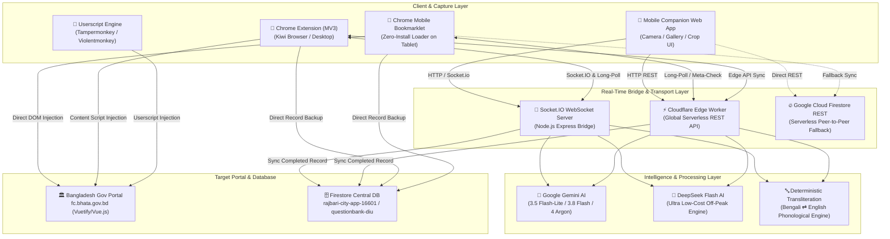
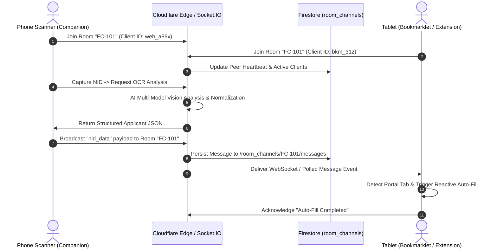

# 🏛️ FamilyCard System Architecture

The **FamilyCard NID AI Scanner & Auto-Filler** system is an end-to-end, multi-tier automation platform engineered to streamline national identity document processing and data entry for Bangladesh's **Family Card (ফ্যামিলি কার্ড)** social safety-net program on [fc.bhata.gov.bd](https://fc.bhata.gov.bd/online-application-family-card).

It eliminates the requirement for laptops, high-spec computers, or manual transcription in the field by enabling rapid OCR, cross-device room pairing, AI-driven form auto-completion, and real-time validation across smartphones and locked Android tablets.

---

## 1. High-Level Architectural Overview

The system bridges three primary actor environments through a dual-channel real-time synchronization layer:

---

## 2. Core Components

### 2.1. Mobile Companion Web App (`/public/index.html`, `/app.js`)
- **Role**: Field scanning unit running on an enumerator's smartphone (iOS or Android).
- **Capabilities**:
  - Direct camera video stream integration with real-time aspect-ratio crop frames (ID Card format `mode-id` 85.6mm × 54mm, and A4 Certificate format `mode-a4`).
  - Client-side image downscaling and JPEG optimization (preserving DPI while reducing base64 payload to under 400KB).
  - Mode selection: NID (Smart/Old), Digital Birth Registration Certificate (BRC), or Automatic Detection.
  - Operator controls for Religion, Marital Status, and manual Phone Number.
  - Real-time live room messenger for communicating field notes and mobile numbers between the scanner phone and data entry tablet.
  - Live cost tracking meter displaying USD and BDT estimates per 1,000 scans based on current time-of-day API pricing.

### 2.2. Chrome Bookmarklet Engine (`/bookmarklet/`)
- **Problem Solved**: Government-issued field tablets frequently possess locked Google Play Stores, disabled developer options, and strict MDM policies preventing APK installations or browser extension side-loading.
- **Architecture**:
  - **1-Line Loader Bookmarklet (`loader.min.js`)**: Executes network-first dynamic evaluation with a 2.6-second abort controller.
  - **Local Storage Cache**: Caches verified bundles under version keys (`fc_app_v19`, `fc_app_v18`, `fc_app_v15`). If offline, the cached bundle executes instantly.
  - **Zero-DOM Pollution**: Loads asynchronously into `fc.bhata.gov.bd`, binds to native Vue components, and injects a non-intrusive floating action bar (`#fc-floating-btn`).
  - **Userscript Alternative (`familycard.user.js`)**: Compatible with Tampermonkey/Violentmonkey on Firefox Android or Kiwi Browser.

### 2.3. Manifest V3 Browser Extension (`/extension/`)
- **Role**: Full-featured browser extension designed for Kiwi Browser (Android) and Chromium on Desktop/Laptops.
- **Architecture**:
  - `manifest.json`: Manifest V3 specification with `declarativeNetRequest`, `storage`, and active tab permissions.
  - `background.js`: Persistent background service worker managing connection states and extension badge counters.
  - `content.js`: Form automation brain exceeding 8,000 lines, implementing field observers, Vuetify select dispatchers, and input guards.
  - `popup.html` / `popup.js`: Quick configuration panel for default room pairing, server endpoints, and API keys.

### 2.4. Hybrid Backend Services
The architecture implements a triple-redundant backend to ensure zero downtime in remote rural areas with unstable connectivity:

1. **Local / Node.js Server (`/server/server.js`)**:
   - Express 4.x + Socket.IO 4.8.
   - Handles low-latency local area network (LAN) websocket events when field teams share an offline mobile hotspot.
   - Hosts Gemini 3.5/3.8 and DeepSeek API proxies, error log collectors, and room routing.

2. **Cloudflare Serverless Edge Worker (`/cloudflare/worker.js`)**:
   - Deployed on Cloudflare Pages / Workers (`https://familycard.afridi.app` and `https://familycard-10n.pages.dev`).
   - Globally distributed, sub-50ms cold starts, eliminates server provisioning overhead.
   - Proxies Google Firestore REST requests, bypassing Firestore CORS restrictions in browser sandboxes.

3. **Google Cloud Firestore REST Tier**:
   - Database projects: `rajbari-city-app-16601` (primary) and `questionbank-diu` (backup).
   - Direct HTTP REST API fallback (`/databases/(default)/documents/room_channels/{roomCode}`) enabling client-to-client communication even if both Node.js and Cloudflare edge endpoints are temporarily unreachable.

---

## 3. Communication & Synchronization Protocols

### 3.1. Room-Based Pairing Protocol
Data entry operators pair a scanner smartphone with a target tablet using an alphanumeric Room Code (default: `FC-101`):

### 3.2. Heartbeat & Presence Tracking
- Every active participant generates a persistent client ID (e.g. `web_xxxxxx` for companion, `bkm_xxxxxx` for bookmarklet, `ext_xxxxxx` for extension).
- Every 4–8 seconds, peers report heartbeat stamps to the room channel metadata document.
- Inactive peers are marked offline if `Date.now() - lastSeen > 25000ms`, updating the UI presence pill in real time.

---

## 4. Resilience, Offline Caching & Failover Matrix

| Failure Mode | Detection Mechanism | Automated Failover Route | User Impact |
| :--- | :--- | :--- | :--- |
| **Node.js Server Offline** | Socket.IO disconnect event | Automatic switch to Cloudflare Edge API (`/api/ocr-nid`) | Zero impact; transparent to operator |
| **Edge Server Degraded** | HTTP 5xx / 404 response | Direct fallback to Google Firestore REST channels | Seamless fallback; polling interval adjusts to 3s |
| **Internet Intermittent** | AbortController 2.6s timeout | Bookmarklet loads from `localStorage` (`fc_app_v19`) | Portal injection continues without reload |
| **AI Model Rate Limit (429)** | API response code `RESOURCE_EXHAUSTED` | Automatic failover: Gemini 3.5 Lite ➔ 3.8 Flash ➔ DeepSeek Flash | Scan completes with secondary engine |
| **DeepSeek Peak Hours** | UTC schedule evaluation | Auto-switches to Gemini Flash-Lite to avoid surge rates | Maximizes cost-efficiency |
| **Field Dom Mutation** | Vuetify reactive model drop | Polling watchers re-trigger input events (`input`, `change`, `blur`) | Form entries persist across step switches |

---

## 5. Security & Isolation Architecture

1. **Zero Secret Leakage on Client**:
   - Production deployments route AI vision requests through Cloudflare Edge Secrets (`GEMINI_API_KEY`, `DEEPSEEK_API_KEY`) so field operators do not need private keys stored in their browsers.
   - User-supplied API keys (if configured) are saved strictly to the browser's origin-isolated `localStorage`.

2. **Cross-Origin Resource Sharing (CORS)**:
   - Configured via `firebase.json` and Cloudflare Worker headers (`Access-Control-Allow-Origin: *`) to allow safe injection inside `fc.bhata.gov.bd` frames without cross-origin script blocking.

3. **Firestore Security Rules (`firestore.rules`)**:
   - Granular document matching restricted to collections `family_cards`, `room_channels`, and `fc_error_logs`.
   - Wildcard document write denials for administrative database paths (`match /{document=**} { allow read, write: if false; }`).

4. **Input Sanitization & Reactive Protection**:
   - All string injections run through `escapeHtml()` and Bengali-to-English numeral normalization routines.
   - User edits made manually on the portal form are guarded: automated scripts do not overwrite fields already typed by the human operator unless explicitly commanded via "পুনরায় পূরণ করুন" (Refill).
