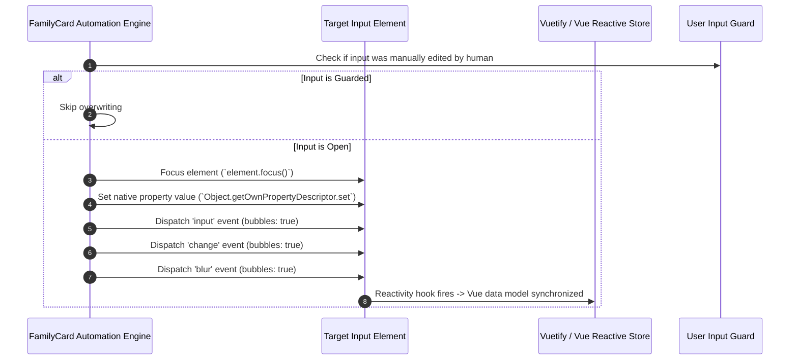

# 📋 Government Portal Form Automation Specification

This document details the reverse-engineered schema, reactive DOM interaction model, field selectors, and multi-section automation algorithms implemented for Bangladesh's government Family Card application portal:
👉 **Target URL**: `https://fc.bhata.gov.bd/online-application-family-card`

---

## 1. Technical Architecture of Target Portal

The portal is a Single Page Application (SPA) built using **Vue.js** and the **Vuetify** Material Design component library. 

### Why Standard Browser Automation Scripts Fail:
1. **Virtual DOM Reactivity**: Directly assigning an input value (e.g., `input.value = "123"`) updates the visual DOM but **fails to notify Vue's internal model**. Upon clicking "Next" or submitting, the form treats the input as empty.
2. **Dynamic Swapping**: When the user switches between "জাতীয় পরিচয়পত্র" (NID) and "জন্ম নিবন্ধন" (BRC), Vuetify destroys the active `<input>` and mounts a new element asynchronously.
3. **Complex Dropdowns**: `<select>` elements are simulated via Vuetify `.v-select` and `.v-autocomplete` components. Options exist inside a global detached overlay menu (`.v-menu__content`) rather than standard `<option>` tags.

### Our Reactive Dispatcher Pipeline:


---

## 2. Step-by-Step Form Automation Spec

```
┌────────────────────────────────────────────────────────────────────────┐
│                        PORTAL TAB HIERARCHY                            │
├────────────┬─────────────────────────────┬─────────────────────────────┤
│ Tab Index  │ Section / Tab Name          │ Automation Scope            │
├────────────┼─────────────────────────────┼─────────────────────────────┤
│ Tab 0      │ প্রাথমিক যাচাইকরণ (Verification) │ NID/BRC, DOB, Captcha Assist│
│ Tab 1      │ ব্যক্তিগত তথ্য (Personal Info)  │ Names (BN/EN), Parents, Rel │
│ Tab 2      │ ছবি ও সনাক্তকরণ (Media/Images)│ Photo, NID Card Image Check │
│ Tab 3      │ যোগাযোগের ঠিকানা (Address)     │ Location Smart Defaults     │
│ Tab 4      │ খানার ডেমোগ্রাফিক (Household) │ Members, MFS, Expatriates   │
│ Tab 5      │ ব্যাংক বা এমএফএস (Payment)    │ bKash, Nagad, Rocket Sync   │
│ Tab 6      │ যোগ্যতার অন্যান্য তথ্য (Criteria) │ 15+ Socioeconomic Defaults  │
│ Tab 7      │ খানার সদস্য তথ্য (Family List)│ Dynamic Multi-Member Rows   │
│ Tab 8      │ অর্থ ব্যবহার (Demand Plan)   │ 2,500 TK Dynamic Allocator  │
└────────────┴─────────────────────────────┴─────────────────────────────┘
```

---

### Step 0: Verification & Citizen Lookup (প্রাথমিক যাচাই)

```javascript
// Verification Type Selector
const isBirthReg = data.doc_type === 'birth_certificate';
await ensureVerificationRadio(scope, isBirthReg);
```

1. **Document Type Selection**:
   - Locates `.v-radio` elements matching keywords `জাতীয় পরিচয়পত্র` (NID) or `জন্ম নিবন্ধন` (Birth Certificate).
   - Toggles the correct radio button based on the extracted `doc_type`.
2. **Identification Number Input**:
   - Smart NID: 10 digits.
   - Old NID: Prepend 4-digit birth year $\rightarrow$ 17 digits.
   - Digital BRC: 17 digits.
3. **Date of Birth (`dob`)**:
   - Formatted to `YYYY-MM-DD` or `DD/MM/YYYY` to match Vuetify date-picker input masks.
4. **Captcha Verification Handler**:
   - Highlights the captcha input for the operator.
   - Observes the verification response. Once verified, the portal unlocks Tab 1.

---

### Step 1: Personal Information (ব্যক্তিগত তথ্য)

Once verified, citizen details are fetched by the government API. The FamilyCard engine fills in missing attributes:

| Field Name | Selector Keywords | Normalized Value / Format | Fallback Action |
| :--- | :--- | :--- | :--- |
| **নাম (বাংলা)** | `আবেদনকারীর নাম (বাংলা)`, `পূর্ণ নাম (বাংলা)` | Extracted Bengali string | Kept from NID verification |
| **নাম (ইংরেজি)** | `আবেদনকারীর নাম (ইংরেজি)`, `Name (English)` | Extracted English string in **ALL CAPS** | Transliterated from Bengali |
| **পিতার নাম (বাংলা)** | `পিতার নাম (বাংলা)`, `পিতা (বাংলা)` | Extracted Bengali string | Prompt operator if missing |
| **পিতার নাম (ইংরেজি)**| `পিতার নাম (ইংরেজি)`, `Father's Name (English)` | **ALL CAPS English** | Phonological AI transliteration |
| **মাতার নাম (বাংলা)** | `মাতার নাম (বাংলা)`, `মাতা (বাংলা)` | Extracted Bengali string | Prompt operator if missing |
| **মাতার নাম (ইংরেজি)**| `মাতার নাম (ইংরেজি)`, `Mother's Name (English)` | **ALL CAPS English** | Phonological AI transliteration |
| **লিঙ্গ (Gender)** | `লিঙ্গ`, `পুরুষ/নারী/হিজড়া` | `পুরুষ` (Male) / `নারী` (Female) | Inferred from name / prefixes |
| **বৈবাহিক অবস্থা** | `বৈবাহিক অবস্থা`, `Marital Status` | `বিবাহিত` (Married, default), `অবিবাহিত`, `বিধবা` | Inferred from spouse field or UI |
| **ধর্ম (Religion)** | `ধর্ম`, `Religion` | `ইসলাম` (Default), `হিন্দু`, `বৌদ্ধ`, `খ্রিস্টান` | Operator setting |
| **জাতীয়তা** | `জাতীয়তা`, `Nationality` | `বাংলাদেশী` | Set automatically |
| **মোবাইল নম্বর** | `মোবাইল নম্বর`, `আবেদনকারীর মোবাইল নম্বর` | 11-digit mobile (`01XXXXXXXXX`) | Transferred from Room Chat |

---

### Section 3: Photo & Document Image Guardian

The Image Guardian monitors image attachments:
- **Requirements**:
  1. Citizen Portrait Photo.
  2. NID Front Side.
  3. NID Back Side.
- **HUD Indicator**: Displays a floating status widget (`০/৩`, `১/৩`, `২/৩`, or `৩/৩ - সম্পূর্ণ`).
- **Persistence**: Synchronizes media metadata to Firestore document `family_cards/{docId}`.

---

### Section 4: Address Defaults (যোগাযোগের ঠিকানা)

To eliminate repetitive manual selection across hundreds of local applications, the engine injects operator-configured geographic defaults:

```javascript
const defaultAddress = {
  division: "ঢাকা",
  district: "রাজবাড়ী",
  upazila: "পাংশা",
  union: "কসবামাজাইল",
  ward: "০৩",
  village: "কসবামাজাইল",
  postcode: "৭৭২০"
};
```

1. Selects the Administrative Division (`বিভাগ`).
2. Waits for cascading AJAX population of District (`জেলা`).
3. Selects Upazila (`উপজেলা`) $\rightarrow$ Union (`ইউনিয়ন`) $\rightarrow$ Ward (`ওয়ার্ড`).
4. Injects Village (`গ্রাম/মহল্লা`) and Post Code (`পোস্ট কোড`).

---

### Section 5 & Cross-Matching Engine (খানার ডেমোগ্রাফিক)

Captures household composition metrics required for demographic scoring:
- **পুরুষ সদস্য (Male Members)**: Numeric count.
- **নারী সদস্য (Female Members)**: Numeric count.
- **হিজড়া সদস্য (Hijra Members)**: Numeric count (default: 0).
- **মোট সদস্য (Total Members)**: Computed sum:
  $$\text{Total} = \text{Male} + \text{Female} + \text{Hijra}$$
- **এমএফএস একাউন্টধারী সদস্য**: Number of active MFS accounts.
- **প্রশিক্ষণপ্রাপ্ত সদস্য**: Members with vocational training.
- **প্রবাসী সদস্য**: Members residing abroad sending remittances.

---

### Section 6: Payment & Financial Channels (ব্যাংক বা এমএফএস)

Supports mobile financial services (MFS) and banking:
- **Service Types**: `বিকাশ` (bKash), `নগদ` (Nagad), `রকেট` (Rocket), `উপায়` (Upay), or `ব্যাংক হিসাব` (Bank).
- **Account Number Verification**:
  - Validates 11-digit mobile numbers against official operator prefixes (`013`, `014`, `015`, `016`, `017`, `018`, `019`).
- **Account Name**: Must match applicant or nominee name.

---

### Section 7: Socioeconomic Eligibility (যোগ্যতার অন্যান্য তথ্য)

Contains 15+ complex socio-economic questions that must maintain strict consistency with Section 5 to avoid rejection during government review:

```javascript
// Cross-Validation Rule Example: Foreign Remittance
const sec5Expatriates = getSection5AbroadCount();
if (sec5Expatriates > 0) {
  // Foreign income must be marked "হ্যাঁ" (Yes)
  selectDropdownByLabel('বিদেশে অবস্থানরত কারো নিকট হতে কোন অর্থ গ্রহণ করেছে কি?', ['হ্যাঁ', 'হ্যা']);
} else {
  // Must be marked "না" (No)
  selectDropdownByLabel('বিদেশে অবস্থানরত কারো নিকট হতে কোন অর্থ গ্রহণ করেছে কি?', ['না']);
}
```

#### Smart Defaults Matrix for Section 7:
1. **খানার প্রধান বাসস্থান**: `নিজস্ব` (Owned).
2. **ঘরের প্রধান উপকরণ (দেয়াল)**: `টিন` (Tin sheet) or `আধাপাকা`.
3. **ঘরের প্রধান উপকরণ (ছাদ)**: `টিন` (Tin).
4. **বিদ্যুৎ সুবিধা**: `আছে` (Connected).
5. **নিরাপদ পানির উৎস**: `নলকূপ` (Tube well).
6. **পায়খানার ধরন**: `স্যানিটারি ল্যাট্রিন (ফ্লাশযুক্ত)` or `স্যানিটারি ল্যাট্রিন (রিং স্ল্যাব)`.
7. **খানার সদস্য সংখ্যা**: **Strictly auto-synced** with Section 5 total members in Bengali numerals.

---

### Section 8: Family Members Multi-Row Automation

Supports adding multiple family dependents (spouse, children, parents):
1. Clicks "নতুন সদস্য যোগ করুন" (Add Member button).
2. Generates modal or table row.
3. Automatically switches between NID and Birth Certificate for children under 18.
4. Fills Member Name, Relation, Age, Marital Status, and Educational Status.
5. Tracks student status, chronic illnesses, and disabilities to feed Section 9.

---

### Section 9: 2,500 BDT Dynamic Demand Allocation Algorithm

The Family Card program requires a planned financial breakdown totaling exactly **2,500 BDT**. The engine calculates and distributes the funds based on family composition:

```javascript
function computeAIDemandDistribution(conditions = {}) {
  const { totalMembers = 5, studentCount = 0, hasDisabledOrElderly = false } = conditions;
  let education = 0;
  let food = 1500;
  let medical = 500;
  let business = 500;

  if (studentCount > 0) {
    // Household with students: prioritize education
    education = studentCount >= 2 ? 800 : 500;
    food = 1200;
    medical = hasDisabledOrElderly ? 500 : 300;
    business = 2500 - (education + food + medical);
  } else {
    // No students: zero education allocation, redistribute to food and livelihood
    education = 0;
    food = totalMembers >= 6 ? 1600 : 1400;
    medical = hasDisabledOrElderly ? 600 : 400;
    business = 2500 - (food + medical);
  }

  return { education, food, medical, business, total: 2500 };
}
```

The algorithm guarantees:
$$\text{Education} + \text{Food} + \text{Medical} + \text{Business} = 2,500\text{ BDT}$$
Eliminates submission rejections caused by arithmetic discrepancy.
