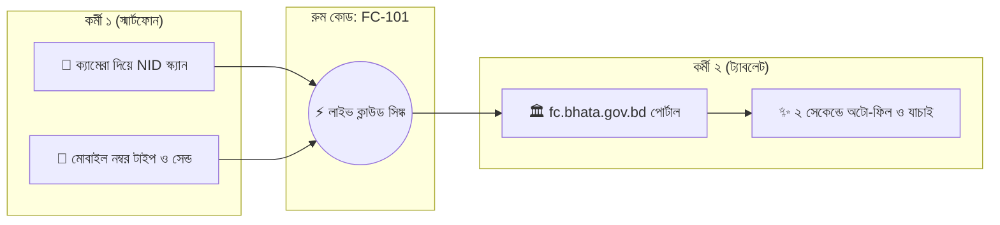

# 📖 মাঠ পর্যায়ের অপারেটর ও এনিউমারেটর নির্দেশিকা
## Field Operator & Enumerator Manual (Bilingual: বাংলা ও English)

এই নির্দেশিকাটি মাঠ পর্যায়ের তথ্য সংগ্রহকারী (Enumerator), ইউনিয়ন ডিজিটাল সেন্টার (UDC) উদ্যোক্তা এবং সরকারি ফ্যামিলি কার্ড ডেটা এন্ট্রি অপারেটরদের জন্য প্রণীত।

This manual provides operational guidance for field enumerators, digital center entrepreneurs, and data entry operators conducting Family Card registrations on [fc.bhata.gov.bd](https://fc.bhata.gov.bd/online-application-family-card).

---

## ১. কাজের দুটি প্রধান পদ্ধতি (Two Operational Workflows)

আপনার সুবিধার্থে সিস্টেমটি দুটি ভিন্ন পদ্ধতিতে ব্যবহার করা যায়:

```
┌────────────────────────────────────────────────────────────────────────┐
│                   অপারেশনাল পদ্ধতির তুলনা                              │
├────────────────────┬───────────────────────────────────────────────────┤
│ পদ্ধতি ১: একক ডিভাইস│ ১টি মাত্র অ্যান্ড্রয়েড ট্যাবলেট (Google Chrome)     │
│ (Single Device)    │ ট্যাবলেটেই ক্যামেরা ও ফর্ম অটো-ফিল (বুকমার্কলেট)   │
├────────────────────┼───────────────────────────────────────────────────┤
│ পদ্ধতি ২: ডুয়াল ডিভাইস│ ফোন দিয়ে ছবি তোলা + ট্যাবলেটে অটো-ফিল             │
│ (Dual Device Pair) │ ২ জন কর্মী একসাথে কাজ করতে পারবেন (রুম সিঙ্ক)     │
└────────────────────┴───────────────────────────────────────────────────┘
```

---

## ২. পদ্ধতি ১: ১টি মাত্র ডিভাইস (ট্যাবলেট গুগল ক্রোম) ব্যবহার

আপনার সরকারি ট্যাবলেটে প্লে-স্টোর লক থাকলেও এবং নতুন কোনো অ্যাপ ইনস্টল করার অনুমতি না থাকলেও **ডিফল্ট গুগল ক্রোম** ব্রাউজার দিয়েই সম্পূর্ণ কাজ করা সম্ভব।

### সেটআপ ধাপসমূহ (১ বার করলেই হবে):
1. ট্যাবলেটের ক্রোম ব্রাউজারে বুকমার্কলেট হেল্পার পেজটি ওপেন করুন:  
   👉 **`https://familycard.afridi.app/bookmarklet/`**
2. পেজের বড় সবুজ বাটনে চাপ দিন: **"📋 বুকমার্ক কোড কপি করুন"**।
3. ক্রোমের উপরে থ্রি-ডট (⋮) মেনু থেকে **স্টার (⭐)** আইকনে চাপ দিয়ে যেকোনো পেজ বুকমার্ক করুন।
4. এরপর বুকমার্ক এডিট করুন:
   - **Name (নাম)**: লিখুন `nid`
   - **URL (ঠিকানা)**: পূর্বের লেখা মুছে কপি করা কোডটি পেস্ট করুন।
5. সেভ করে বেরিয়ে আসুন।

### প্রতিদিনের কাজের নিয়ম:
1. সরকারি পোর্টালে যান: `https://fc.bhata.gov.bd/online-application-family-card`
2. ক্রোমের অ্যাড্রেসবারে লিখুন `nid`।
3. নিচে ড্রপডাউনে স্টার চিহ্নিত `nid` বুকমার্কটি আসবে, সেটিতে ট্যাপ করুন।
4. সাথে সাথে স্ক্রিনের ডানপাশে ভাসমান **`📸 NID স্ক্যান`** বাটন চলে আসবে!
5. বাটনে চাপ দিয়ে ক্যামেরায় এনআইডি বা জন্ম নিবন্ধনের ছবি তুলুন — **মাত্র ২ সেকেন্ডে ফর্ম পূরণ হয়ে যাবে!**

---

## ৩. পদ্ধতি ২: ডুয়াল-ডিভাইস রুম পেয়ারিং (স্মার্টফোন + ট্যাবলেট)

যখন দ্রুত গতিতে শত শত আবেদন করতে হয়, তখন ২ জনের একটি টিম হিসেবে কাজ করা সবচেয়ে কার্যকর:
- **কর্মী ১ (সহকারী)**: স্মার্টফোন দিয়ে নাগরিকদের লাইনে দাঁড়িয়ে এনআইডি কার্ডের ছবি তুলবেন।
- **কর্মী ২ (অপারেটর)**: সরকারি ট্যাবলেটে বসে যাচাই ও আবেদন চূড়ান্ত করবেন।



### পেয়ার করার সহজ নিয়ম:
1. **স্মার্টফোনে**: ব্রাউজারে খুলুন `https://familycard.afridi.app`।
   - রুম কোড দিন: `FC-101` (অথবা আপনার পছন্দমতো যেকোনো কোড)।
   - "🔗 রুম কানেক্ট করুন" বাটনে চাপ দিন।
2. **ট্যাবলেটে**: সরকারি পোর্টাল খুলে বুকমার্কলেট চালু করুন এবং সেটিংস ড্রয়ারে একই রুম কোড `FC-101` দিন।
3. উভয় ডিভাইসের স্ট্যাটাস পিল **সবুজ (🟢 ২ অনলাইন)** হয়ে যাবে।
4. এখন স্মার্টফোনে ছবি তোলার সাথে সাথে ট্যাবলেটের ফর্ম নিজে নিজেই পূরণ হয়ে যাবে!

---

## ৪. ছবি তোলার নিয়ম ও নির্ভুল OCR টিপস (Camera Best Practices)

AI যাতে ১০০% নির্ভুলভাবে বাংলা ও ইংরেজি নাম, পিতার নাম ও এনআইডি নম্বর পড়তে পারে, তার জন্য নিচের বিষয়গুলো খেয়াল রাখুন:

1. **নীল ফ্রেমের ভেতরে রাখুন**:
   - এনআইডি কার্ডের জন্য: `🪪 NID (ID কার্ড)` ফ্রেম সিলেক্ট করুন।
   - ডিজিটাল জন্ম সনদের জন্য: `📄 জন্ম নিবন্ধন (A4)` ফ্রেম সিলেক্ট করুন।
2. **আলো ও গ্লেয়ার (Glare) পরিহার করুন**:
   - প্লাস্টিক লেমিনেটিং করা কার্ডে সরাসরি বাল্ব বা সূর্যের আলোর প্রতিফলন পড়লে লেখা সাদা হয়ে যায়। কার্ডটি সামান্য কাত করে ছবি তুলুন।
3. **পুরনো ১৩ ডিজিটের কার্ডের ক্ষেত্রে**:
   - কার্ডের নিচে বা উপরে জন্ম তারিখ যাতে স্পষ্ট দেখা যায় তা নিশ্চিত করুন। কারণ জন্ম তারিখের সাল (যেমন: `1985`) নিয়ে সিস্টেম স্বয়ংক্রিয়ভাবে ১৭ ডিজিট তৈরি করে।
4. **হাত স্থির রাখুন**:
   - ছবি ঝাপসা (blur) হলে AI অক্ষর চিনতে ভুল করতে পারে। ফোকাস সবুজ হলে ক্যাপচার বাটনে চাপ দিন।

---

## ৫. ধাপে ধাপে ফর্ম যাচাই চেকলিস্ট (Application Checklist)

প্রতিটি আবেদন সাবমিট করার আগে নিচের ধাপগুলো দ্রুত চোখ বুলিয়ে নিন:

| ধাপ / সেকশন | অপারেটরের দায়িত্ব | সিস্টেমে স্বয়ংক্রিয় ব্যবস্থা |
| :--- | :--- | :--- |
| **ধাপ ০: যাচাইকরণ** | ক্যাপচা কোডটি টাইপ করে "যাচাই করুন" বাটনে চাপ দিন। | ১০/১৭ ডিজিট নম্বর ও জন্ম তারিখ স্বয়ংক্রিয়ভাবে বসে যায়। |
| **ধাপ ১: ব্যক্তিগত তথ্য** | পিতা ও মাতার ইংরেজি বানান এবং ধর্ম চেক করুন। | AI স্বয়ংক্রিয়ভাবে ক্যাপিটাল ইংরেজি বানান তৈরি করে। |
| **সেকশন ৩: ছবি ও ডকুমেন্ট** | ৩/৩ সবুজ হয়েছে কিনা দেখুন (নাগরিক ছবি + এনআইডি ফ্রন্ট/ব্যাক)। | HUD উইজেটে ০/৩ থেকে ৩/৩ রেশিও নির্দেশ করে। |
| **সেকশন ৪: ঠিকানা** | আপনার বর্তমান ইউনিয়ন ও ওয়ার্ড ঠিক আছে কিনা দেখুন। | ডিফল্ট সেটিং অনুযায়ী গ্রাম ও পোস্ট কোড বসে যায়। |
| **সেকশন ৫ ও ৭: ক্রস-ম্যাচ** | হলুদ সতর্কবার্তা নেই তা নিশ্চিত করুন। | সেকশন ৫-এর সদস্য সংখ্যা ও সেকশন ৭-এর সংখ্যা অটো-সিঙ্ক হয়। |
| **সেকশন ৬: পেমেন্ট/MFS** | বিকাশ/নগদ নম্বরটি আবেদনকারীর সাথে মিলিয়ে নিন। | চ্যাট থেকে এক ক্লিকে নম্বর পেস্ট করা যায়। |
| **সেকশন ৯: টাকা বণ্টন** | মোট টাকা ২৫০০/- হয়েছে কিনা নিশ্চিত করুন। | শিক্ষার্থী ও বয়োবৃদ্ধদের অবস্থা অনুযায়ী ২৫০০ টাকার সঠিক বণ্টন। |

---

## ৬. সচরাচর জিজ্ঞাস্য ও সমাধান (Field Troubleshooting & FAQ)

### প্র: ট্যাবলেটে বুকমার্কে চাপ দিলে কিছুই আসে না কেন?
**উ:** আপনি হয়তো সরকারি পোর্টাল (`fc.bhata.gov.bd`) লোড হওয়ার আগেই বুকমার্কে চাপ দিয়েছেন। পেজটি সম্পূর্ণ লোড হতে দিন, তারপর অ্যাড্রেসবারে `nid` লিখে বুকমার্কে ট্যাপ করুন।

### প্র: পুরনো ১৩ ডিজিটের এনআইডি দিলে লাল দাগ আসে কেন?
**উ:** সরকারি পোর্টাল সরাসরি ১৩ ডিজিট গ্রহণ করে না, ১৭ ডিজিট চায়। আমাদের সিস্টেম কার্ডের জন্ম সাল (YYYY) পূর্বে যোগ করে স্বয়ংক্রিয়ভাবে ১৭ ডিজিট বানিয়ে দেয়। কার্ডে জন্ম তারিখ অস্পষ্ট থাকলে ম্যানুয়ালি জন্ম সালটি ১৩ ডিজিটের পূর্বে লিখে দিন।

### প্র: স্মার্টফোন ও ট্যাবলেট কানেক্ট হচ্ছে না (হলুদ দেখাচ্ছে)?
**উ:** 
1. নিশ্চিত করুন দুটি ডিভাইসেই একই রুম কোড (যেমন: `FC-101`) লেখা আছে।
2. ডিভাইসে ইন্টারনেট সংযোগ আছে কিনা চেক করুন।
3. "🔗 রুম কানেক্ট করুন" বাটনে পুনরায় চাপ দিন।

### প্র: পিতা বা মাতার ইংরেজি নাম ভুল আসলে কী করব?
**উ:** আমাদের ফোনেটিক এআই ৯৯% ক্ষেত্রে নির্ভুল নাম তৈরি করে। তবে স্থানীয় কোনো বিশেষ বানানের ক্ষেত্রে ফিল্ডে সরাসরি হাত দিয়ে টাইপ করে সংশোধন করতে পারবেন। সিস্টেম আপনার ম্যানুয়াল এডিট সংরক্ষণ করবে এবং মুছে ফেলবে না।
